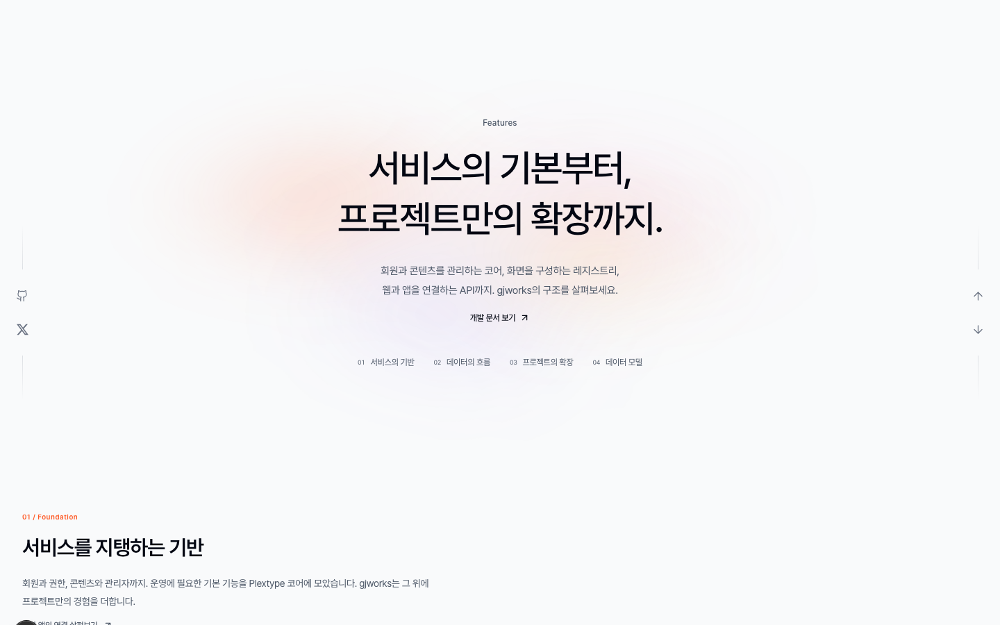
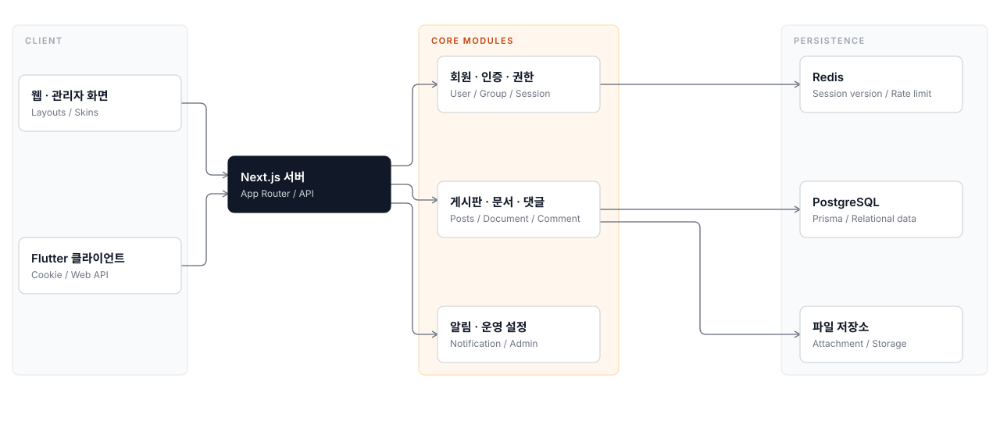
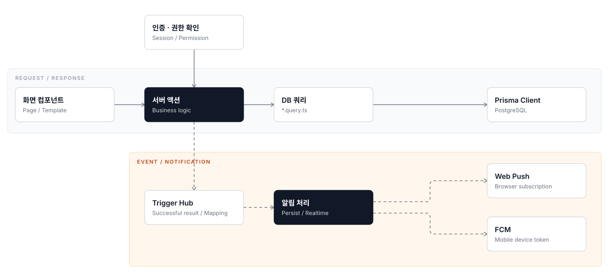
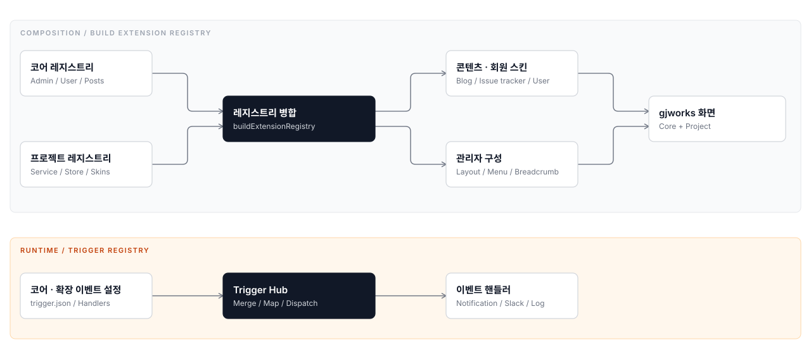
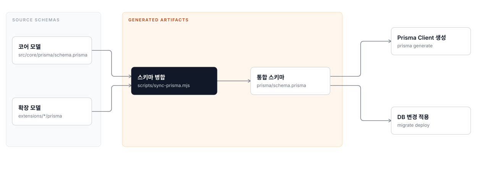
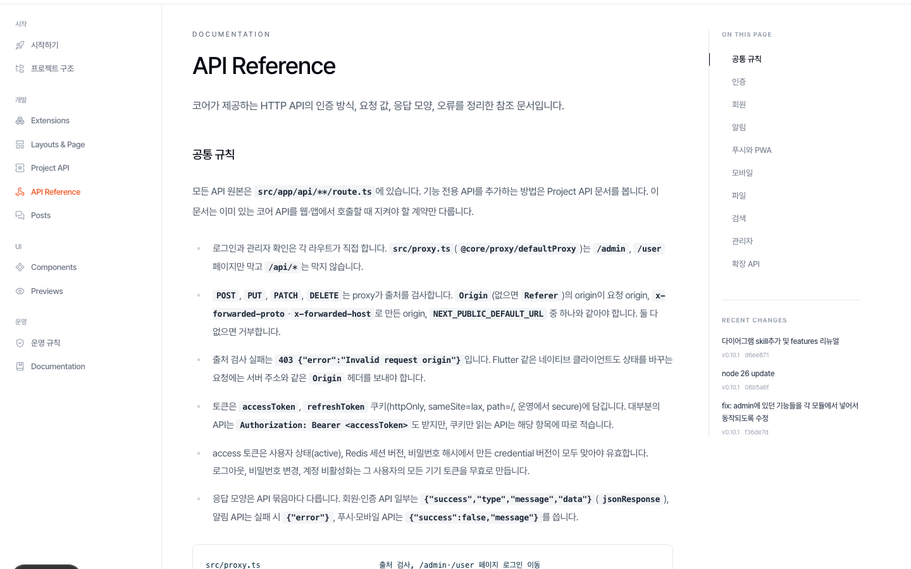

# Plextype

회원, 게시판, 관리자, 알림, 첨부파일을 기본으로 갖춘 Next.js 웹 프레임워크입니다. 코어는 업데이트를 계속 받을 수 있게 두고, 프로젝트마다 다른 기능은 `src/extensions`에 쌓는 구조입니다.



이 README는 두 저장소에 같은 내용으로 실립니다.

- `Gjworks/gjworks_web`: 원본 저장소. Plextype 코어와 gjworks.kr 전용 확장(`src/extensions`)을 함께 개발합니다.
- `Gjworks/plextype`: 배포판. 원본에서 전용 확장을 걸러낸 코어만 들어 있고, 새 프로젝트는 여기서 시작합니다.

## 기술 스택

| 영역 | 사용 기술 |
|---|---|
| 프레임워크 | Next.js 16 (App Router), React 19, TypeScript |
| 스타일 | Tailwind CSS 4 |
| DB | PostgreSQL, Prisma 7 |
| 세션·캐시 | Redis (ioredis) |
| 인증 | JWT access·refresh 토큰 쿠키, 리프레시 토큰 회전, QR 로그인 |
| 알림 | SSE 실시간 알림, Web Push(VAPID), Firebase FCM |
| 실행 환경 | Node.js 26 |

## 기본 기능

- 회원: 가입, 로그인, 프로필, 그룹, 비밀번호 변경·재설정, 로그인 시도 제한
- 게시판: 게시판 모듈, 글·댓글·분류, 그룹별 권한, 스킨
- 관리자: 대시보드, 회원·게시판·사이트·인증·알림·업로드·메일 설정
- 알림: 알림함, 실시간 토스트, 브라우저·모바일 푸시, PWA
- 첨부파일: 형식·용량 검사, 이미지 보정, 권한에 따른 파일 열람
- 통합 검색, 다크 모드, 최초 설치 화면

## 구조와 흐름

작게 시작해 필요한 흐름부터 차례로 연결합니다.

1. 코어를 단단하게: 회원, 게시판, 관리자, 설정처럼 서비스가 굴러가는 데 필요한 기본값을 코어가 맡습니다.
2. 서비스를 연결: 웹 화면, 서버 액션, API, 앱 인증과 알림을 같은 운영 상태 위에서 잇습니다.
3. 모듈을 확장: 프로젝트별 화면과 기능은 `src/extensions`에 두어 코어 업데이트와 분리합니다.

### 서비스를 지탱하는 기반

웹·관리자 화면과 Flutter 클라이언트가 같은 Next.js 서버에 붙고, 코어 모듈이 Redis, PostgreSQL, 파일 저장소를 씁니다. 주요 호출과 저장소 의존 관계만 그렸습니다.



### 역할이 나뉜 요청 처리

화면은 서버 액션만 부르고, 서버 액션이 인증·권한 확인과 업무 로직을, 쿼리 파일이 DB 접근을 맡습니다. 점선은 Trigger가 연결된 액션이 성공했을 때 이어지는 알림 처리이며, Web Push와 FCM은 설정에 따라 실행됩니다.



### 코어 위에 더하는 확장

위쪽은 코어와 프로젝트의 레지스트리를 합쳐 스킨과 관리자 구성을 만드는 경로이고, 아래쪽은 실행 중 이벤트를 처리하는 Trigger 경로입니다. 두 경로는 서로 다른 역할을 합니다.



### 모듈별 모델, 하나의 스키마

코어와 확장의 Prisma 모델을 각자 위치에서 관리하고 하나의 스키마로 합칩니다. 스키마를 합치고 Client를 만드는 것만으로는 DB가 바뀌지 않으며, DB 반영은 마이그레이션으로 따로 합니다.



## 시작하기

Node.js 26, PostgreSQL, Redis가 필요합니다. `npm run setup`이 질문에 답한 값으로 `.env`를 만들고, 패키지 설치, 마이그레이션, Prisma Client 생성, 관리자 계정 seed까지 실행합니다.

```bash
git clone git@github.com:Gjworks/plextype.git
cd plextype
npm run setup
npm run dev
```

- 브라우저에서 `http://localhost:3000`으로 접속합니다.
- setup의 DB·Redis 호스트 기본값은 Docker Compose용인 `postgres`, `redis`입니다. 로컬에 직접 띄운 PostgreSQL·Redis를 쓰면 `localhost`로 입력합니다.
- 관리자 비밀번호 기본값(`password1234`)과 DB 비밀번호 기본값은 예시이므로 setup에서 직접 입력합니다.
- `.env`는 저장소에 올리지 않습니다. 서버와 로컬은 각자 setup으로 만듭니다.

## 명령

| 명령 | 하는 일 |
|---|---|
| `npm run setup` | `.env` 생성, 설치, DB 초기화, 관리자 계정 생성 |
| `npm run dev` | 개발 서버 (포트 3000) |
| `npm run build` / `npm run start` | 운영 빌드와 실행 |
| `npm run prisma:sync` | 코어와 확장의 스키마·마이그레이션을 루트 `prisma/`로 합침 |
| `npm run prisma:generate` | `prisma:sync` 후 Prisma Client 생성 |
| `npm run migrate:dev -- --to <core\|기능 경로> --name <이름>` | 마이그레이션을 만들어 개발 DB에 적용하고 원본 폴더로 옮김 |
| `npm run extensions:check` / `extensions:sync` | 확장의 `routes.json`과 `src/app` 연결 파일을 검사·동기화 |
| `npm run plextype -- <명령>` | Store 패키지를 명령 줄에서 설치·업데이트·제거 (`connect`, `list`, `install`, `migrate`, `remove`, `adopt` 등) |
| `npm run migrate:deploy` | 스키마를 합치고 아직 적용되지 않은 마이그레이션을 개발 DB에 적용 |
| `npm run db:seed` | seed 실행 |
| `npm run release` | 버전과 변경 이력을 올리고 태그와 GitHub Release를 만들어 push. 올리는 대상은 "릴리스" 참고 |

`migrate:reset`과 `dbpush:push`는 DB 내용을 지우거나 마이그레이션 기록 없이 구조를 바꾸므로 개발 DB에서만 씁니다.

## 폴더 구조

```text
src/
├── app/            Next.js 라우트. (modules)는 코어 화면, (extensions)는 확장 연결 파일, api는 HTTP API
├── core/           공용 컴포넌트, 훅, 인증·DB·트리거 유틸, 코어 Prisma 원본
├── modules/        코어 모듈: user, posts, document, comment, attachment, notification, admin, installer
├── layouts/        기본·관리자·인증 레이아웃
├── widgets/        여러 화면이 함께 쓰는 복합 UI
├── extensions/     프로젝트 전용 기능. 배포판에는 들어 있지 않다
├── packages/       쉬운 설치로 Store에서 받은 패키지. 설치기가 관리한다
└── proxy.ts        요청 출처 검사와 페이지 접근 제어. 코어 proxy에 프로젝트 확장을 연결한다
prisma/             prisma:sync가 만드는 결과물. 직접 고치지 않는다
scripts/            스키마·라우트 동기화, 배포판 준비, 테스트
docs/readme/        이 README가 쓰는 이미지
setup.mjs           최초 설치 스크립트
```

데이터는 `화면(.tsx) → 서버 액션(*.action.ts) → 쿼리(*.query.ts)` 순서로만 흐릅니다. 화면에서 쿼리 파일을 직접 가져오지 않습니다.

## 코어와 확장

- 코어(`src/core`, `src/modules`, `src/layouts`, `src/widgets`)는 배포판으로 나가는 영역입니다. 프로젝트 요구는 먼저 확장으로 해결하고, 코어는 여러 프로젝트에 공통으로 필요한 변경만 넣습니다.
- 확장은 `src/extensions/<기능>/` 한 폴더에 화면, 액션, API, 스키마를 모읍니다. 라우트는 기능의 `routes.json`에 적고 `npm run extensions:sync`로 `src/app`에 연결합니다.
- 메뉴·스킨·레이아웃은 `src/extensions/registry.tsx`에서, 코어 이벤트에 붙는 로직은 트리거(`src/core/utils/trigger`)로 등록합니다.
- Store의 패키지는 관리자의 쉬운 설치나 `npm run plextype`으로 `src/packages`에 설치합니다. 라우트 연결과 메뉴·스킨 등록이 설치와 함께 되며, 직접 고치는 대신 같은 key로 `src/extensions`에 등록하거나 내 확장으로 가져와 씁니다. 설치기는 `src/modules/installer/README.md`, 패키지 규칙은 `src/extensions/store/README.md`에 있습니다.

### 요청 단계 접근 제어 확장

`src/proxy.ts`는 코어 proxy(`src/core/proxy/defaultProxy.ts`)에 `@extensions/proxy`를 연결합니다. 이 경로는 `src/extensions/proxy.ts`가 있으면 그 파일을, 없으면 확장이 없는 코어 기본값(`src/core/proxy/defaultProxyExtension.ts`)을 가리키므로 파일을 만들기만 하면 적용됩니다.

```ts
// src/extensions/proxy.ts
import { NextResponse } from "next/server";
import type { ProxyExtension } from "@/core/proxy/defaultProxy";

const adminOnlyPaths = ["/user", "/auth/find", "/auth/reset-password", "/auth/register"];

export const proxyExtension: ProxyExtension = async (request, { getSession }) => {
  const { pathname } = request.nextUrl;
  if (!adminOnlyPaths.some((path) => pathname === path || pathname.startsWith(`${path}/`))) return;

  const session = await getSession();
  if (!session?.isAdmin) return NextResponse.redirect(new URL("/auth/signin", request.url));
};
```

- 코어가 먼저 `/storage/uploads` rewrite, 출처(CSRF) 검사, `/admin` 관리자 확인, `/user` 로그인 확인을 하고, 통과한 요청만 확장에 넘깁니다. 확장은 요청을 더 막을 수만 있고 코어가 막은 요청을 열 수는 없습니다.
- 확장이 응답을 돌려주면 그 응답으로 끝나고, 아무것도 돌려주지 않으면 코어가 요청을 통과시킵니다.
- `getSession()`은 코어가 검증한 `{ id, isAdmin }`을 돌려주며 비로그인이면 `null`입니다. 토큰을 검증할 때 DB와 Redis를 읽으므로 필요한 경로에서만 부릅니다.
- `/_next` 자산 요청에는 확장을 부르지 않습니다.
- `matcher` 같은 Next.js 정적 설정은 `src/proxy.ts`에 직접 적습니다.

## 패키지와 버전

`package.json` 한 파일을 코어와 프로젝트가 함께 고치면 코어를 병합할 때마다 충돌하므로 소유를 나눕니다.

| 항목 | 위치 | 고치는 쪽 |
|---|---|---|
| 코어가 쓰는 npm 패키지 | 루트 `package.json`의 `dependencies` | 코어 |
| 프로젝트·플러그인만 쓰는 npm 패키지 | `src/extensions/package.json` | 프로젝트 |
| Plextype 코어 버전 | `src/core/plextype.json`의 `version` | 코어 릴리스 |
| 프로젝트의 앱 이름과 버전 | 루트 `package.json`의 `name`, `version` | 프로젝트 |

- `src/extensions`는 npm workspace입니다. 루트에서 `npm install`을 한 번 실행하면 코어와 프로젝트 패키지가 함께 설치되고, 폴더가 없는 배포판에서도 그대로 동작합니다.
- 프로젝트 패키지는 `npm install <패키지> -w src/extensions`로 추가합니다. `src/extensions/package.json`이 없으면 아래 내용으로 먼저 만듭니다.
- React, Next.js, Prisma처럼 하나만 설치되어야 하는 패키지는 프로젝트에서 따로 추가하지 않고 코어 버전을 씁니다.
- Docker 이미지를 만들 때 루트 `package.json`만 복사해 `npm install`을 하면 `src/extensions/package.json`의 패키지가 빠집니다. `npm run build`는 시작할 때 이를 확인해 빠진 패키지가 있으면 `npm install`을 한 번 더 실행하므로 Dockerfile을 고치지 않아도 빌드됩니다. 이 단계에서 네트워크를 쓸 수 없는 환경이면 Dockerfile에서 소스를 복사한(`COPY . .`) 다음에 `RUN npm install`을 넣습니다.

- 원본과 배포판의 `package.json` `version`은 `0.1.0`으로 고정되어 있습니다. 릴리스가 이 줄을 바꾸면 자기 버전을 올린 프로젝트가 코어를 병합할 때마다 충돌하기 때문입니다. 프로젝트는 이 값을 자기 앱 버전으로 자유롭게 올립니다.
- `name`도 프로젝트가 자기 앱 이름으로 바꿉니다. 원본은 `plextype`에서 바꾸지 않으므로 병합 충돌이 없고, 릴리스 안내와 System Stack 위젯에 이 이름이 표시됩니다. `npm run setup`이 입력받은 `APP_NAME`으로 바꿔 주며, 나중에 바꿀 때는 `node scripts/set-app-name.mjs <이름>`을 씁니다. 이름은 영문 소문자, 숫자, `.`, `_`, `-`만 쓰고 영문 소문자나 숫자로 시작합니다.
- 관리자 대시보드의 System Stack 위젯이 앱 버전과 Plextype 버전을 따로 보여줍니다.

```json
{
  "name": "project-extensions",
  "private": true,
  "dependencies": {}
}
```

이 구조가 들어오기 전에 루트 `package.json`에 자기 패키지를 추가한 프로젝트는 코어를 병합할 때 그 패키지를 `src/extensions/package.json`으로 옮기고, 루트 `package.json`은 `version`만 자기 값으로 남깁니다.

### 릴리스

`npm run release`(`scripts/release.mjs`)는 저장소 종류에 맞는 release-it 설정을 골라 실행합니다.

| 저장소 | 설정 | 올리는 버전 | 변경 이력 |
|---|---|---|---|
| 배포판을 받아 만든 프로젝트 | `.release-it.json` | `package.json`의 `version` | `CHANGELOG.project.md` |
| Plextype 원본(`Gjworks/gjworks_web`) | `.release-it.plextype.json` | `src/core/plextype.json`의 `version` | `CHANGELOG.md` |

- 원본 저장소는 배포판으로 나가지 않는 `.github/workflows/sync-to-plextype.yml`이 있는지로 구분합니다.
- 두 경우 모두 `chore(release): v<버전>` 커밋과 `v<버전>` 태그를 만들어 push합니다. `GITHUB_TOKEN` 환경 변수가 있으면 GitHub Release도 자동으로 만들고, 없으면 내용이 채워진 작성 화면 링크를 출력합니다.
- 다음 버전은 지난 태그 이후 커밋 메시지의 `fix:`(패치), `feat:`(마이너) 접두사로 정합니다. 접두사를 쓰지 않는 프로젝트는 `npm run release -- 1.2.0`처럼 버전을 직접 줍니다.
- 프로젝트 릴리스는 `main`에 직접 쌓인 커밋만 봅니다(`--first-parent`). `git merge upstream/main`으로 들어온 코어 커밋은 프로젝트의 변경 이력과 다음 버전 계산에 들어가지 않습니다. 코어를 `rebase`로 받으면 코어 커밋이 프로젝트 이력에 직접 쌓여 이 구분이 되지 않으므로 `merge`를 씁니다.
- 프로젝트는 `CHANGELOG.md`와 `src/core/plextype.json`을 고치지 않습니다. 둘은 코어 병합으로만 바뀝니다.
- 프로젝트의 태그와 Plextype의 태그는 둘 다 `v<버전>` 모양이라, 코어를 받을 때 태그는 가져오지 않습니다("코어 업데이트 받기" 참고).

## DB 스키마와 마이그레이션

코어와 각 확장은 같은 모양의 `prisma` 폴더를 가집니다.

```text
src/core/prisma/                      코어
src/extensions/<기능>/prisma/          확장
  schema.prisma 또는 schema/*.prisma    스키마: 모델 정의
  migrations/<14자리 시각>_<이름>/       마이그레이션: DB를 바꾸는 SQL
```

- `npm run prisma:sync`가 이 원본들을 루트 `prisma/schema.prisma`와 `prisma/migrations`로 합칩니다. 배포 때 `prisma migrate deploy`는 합친 폴더를 읽습니다.
- 마이그레이션은 `npm run migrate:dev -- --to core --name add_user_memo`처럼 둘 곳을 정해 만듭니다. 확장은 `--to <기능 경로>`를 씁니다.
- 운영 DB 변경은 백업을 먼저 하고 `prisma migrate deploy`로만 적용합니다.

## 배포판 동기화

`Gjworks/gjworks_web`의 `main`에 push하면 `Sync to Plextype` 워크플로가 배포판을 만듭니다.

1. `src/extensions`, `src/app/(extensions)`, `src/app/(pages)`, `.github`, `AGENTS.md` 등 전용 파일을 이력에서 걸러냅니다.
2. `scripts/prepare-plextype.mjs`가 확장에 연결된 라우트 파일을 지우고 코어 기본 화면을 채웁니다.
3. 걸러낸 상태로 설치와 빌드가 되는지 검사한 뒤 `Gjworks/plextype`에 반영합니다.
4. 같은 파일로 코어 배포본을 만들어 Store에 올립니다(`scripts/publish-core.mjs`). 쉬운 설치의 코어 업데이트가 받는 파일이며, Actions secret `STORE_CORE_PUBLISH_TOKEN`이 없으면 건너뜁니다.

`prepare-plextype.mjs`는 `src/extensions`가 남아 있으면 중단하므로 원본 체크아웃에서는 실행되지 않습니다.

## 코어 업데이트 받기

방법은 둘이고, 프로젝트마다 하나로 정합니다.

- **쉬운 설치**: 관리자의 쉬운 설치 > 코어 업데이트 탭이나 `npm run plextype -- core`로 Store의 코어 배포본을 받습니다. git의 `upstream`이 필요 없습니다. 동작은 `src/modules/installer/README.md`의 "코어 업데이트"에 있습니다.
- **git 병합**: 아래처럼 배포판 저장소를 병합합니다.

배포판에서 시작한 프로젝트는 자기 저장소를 `origin`, 배포판을 `upstream`으로 두고 코어 변경을 병합합니다.

```bash
git remote add upstream https://github.com/Gjworks/plextype.git
git config remote.upstream.tagOpt --no-tags
git fetch upstream
git merge upstream/main
npm install
npm run prisma:generate
```

`tagOpt --no-tags`는 Plextype의 릴리스 태그가 프로젝트 태그와 섞이지 않게 합니다. 받은 코어의 버전은 `src/core/plextype.json`에서 확인합니다. 이 설정 전에 받아 둔 Plextype 태그(`v0.5.0` 이후)가 남아 있으면 앱 버전이 같은 번호에 도달할 때 태그 생성이 실패하므로, 받아 둔 태그를 `git tag -d <태그>`로 지웁니다. 앱 버전을 높은 번호에서 시작하는 것으로는 피할 수 없습니다: Plextype의 버전도 계속 올라갑니다.

병합 뒤 새 마이그레이션이 있으면 개발 DB에는 `npm run migrate:dev`, 운영 DB에는 배포 과정의 `prisma migrate deploy`로 적용합니다. 코어 파일을 직접 고친 프로젝트는 이 병합에서 충돌이 나므로 변경은 확장에 둡니다.

## 검증

```bash
npm run build
npm run extensions:check
node --test scripts/sync-prisma.test.mjs scripts/prepare-plextype.test.mjs
```

## 더 읽을 문서

원본 저장소를 실행하면 `/docs`에서 아래 문서를 볼 수 있습니다. 원본 파일은 `src/extensions/docs/_docs/`에 있습니다.



- 시작하기, 프로젝트 구조, Extensions, Layouts & Page
- Project API: 기능별 API·스키마와 DB 적용 절차
- API Reference: 코어 HTTP API의 인증, 요청, 응답, 오류
- Posts, Components, 운영 규칙

변경 이력은 [CHANGELOG.md](CHANGELOG.md)에 있습니다.
