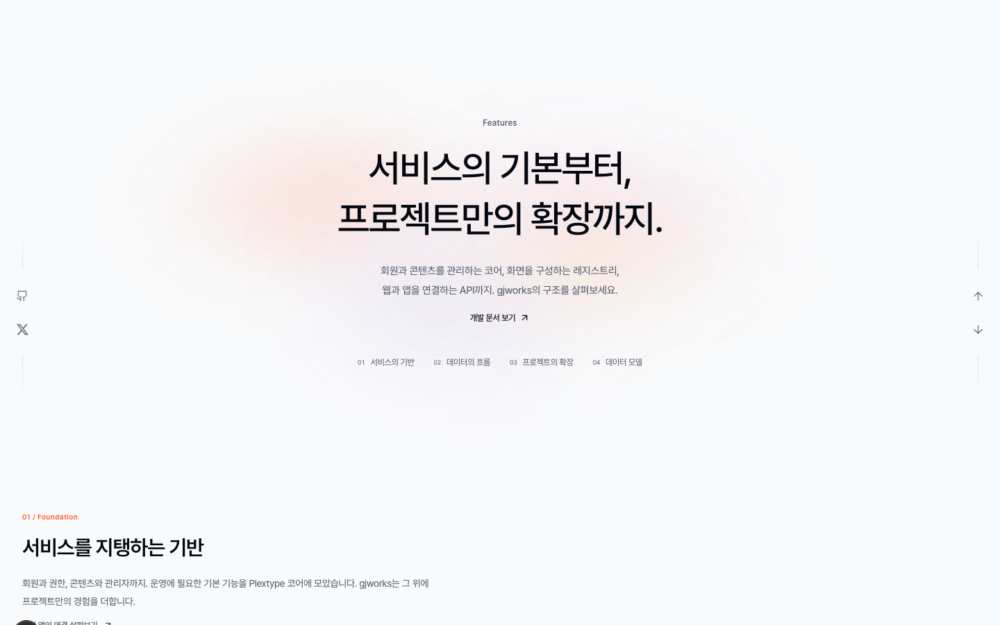
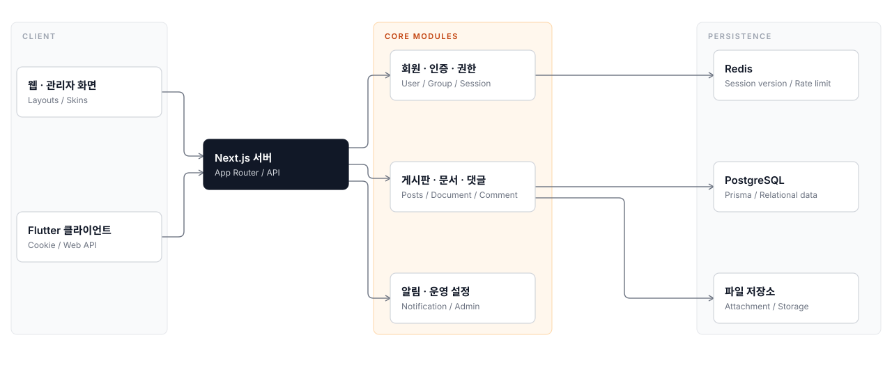
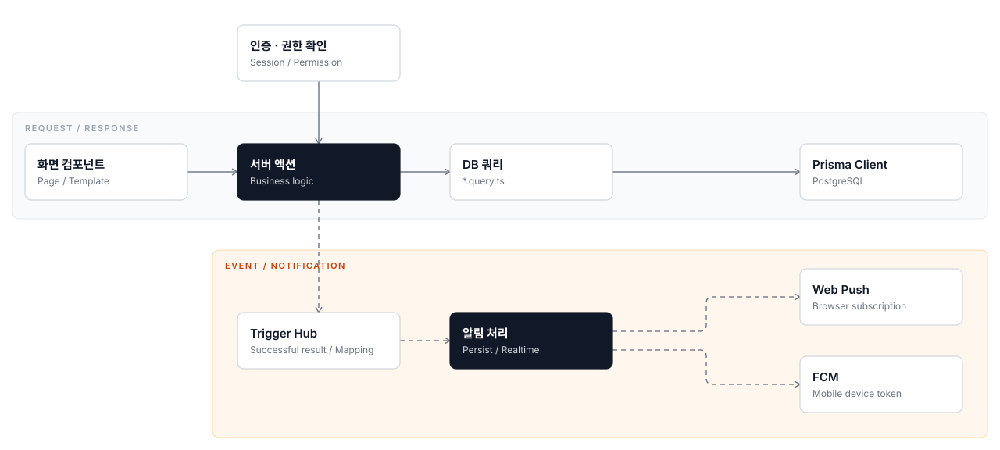
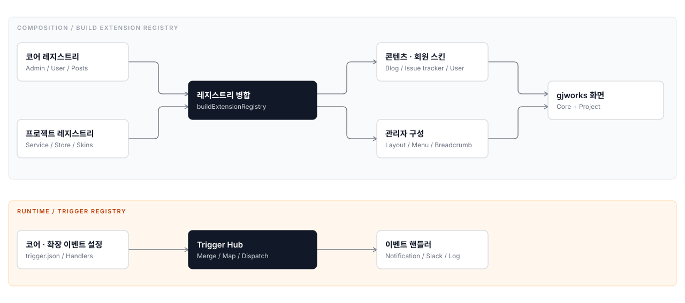
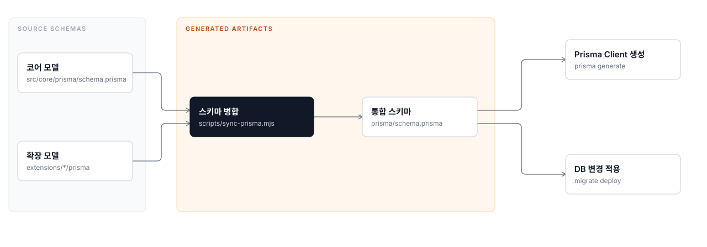
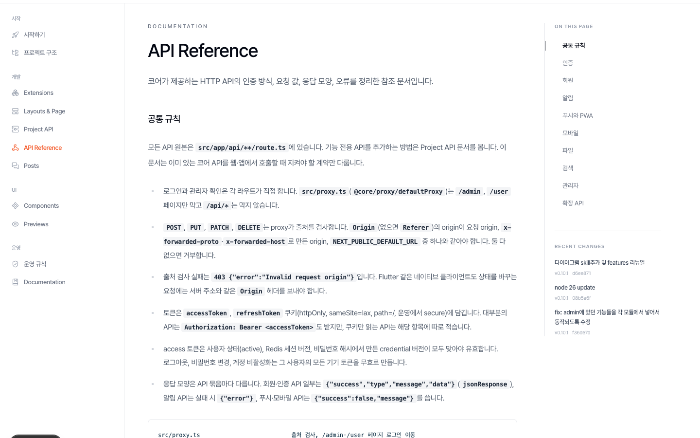

# Plextype

회원, 게시판, 관리자, 알림, 첨부파일을 기본으로 갖춘 Next.js 웹 프레임워크입니다. 코어는 업데이트를 계속 받을 수 있게 두고, 프로젝트마다 다른 기능은 `src/extensions`에 쌓는 구조입니다.



이 README는 두 저장소에 같은 내용으로 실립니다.

- `Gjworks/gjworks_web`: 원본 저장소. Plextype 코어와 gjworks.kr 전용 확장(`src/extensions`)을 함께 개발합니다.
- `Gjworks/plextype`: 배포판. 원본에서 전용 확장을 걸러낸 코어만 들어 있고, 새 프로젝트는 여기서 시작합니다.

## 기술 스택

| 영역 | 사용 기술 |
|---|---|
| 프레임워크 | Next.js 16 (App Router), React 19, TypeScript |
| 스타일 | Tailwind CSS 4 |
| DB | PostgreSQL, Prisma 7 |
| 세션·캐시 | Redis (ioredis) |
| 인증 | JWT access·refresh 토큰 쿠키, 리프레시 토큰 회전, QR 로그인 |
| 알림 | SSE 실시간 알림, Web Push(VAPID), Firebase FCM |
| 실행 환경 | Node.js 26 |

## 기본 기능

- 회원: 가입, 로그인, 프로필, 그룹, 비밀번호 변경·재설정, 로그인 시도 제한
- 게시판: 게시판 모듈, 글·댓글·분류, 그룹별 권한, 스킨
- 관리자: 대시보드, 회원·게시판·사이트·인증·알림·업로드·메일 설정
- 알림: 알림함, 실시간 토스트, 브라우저·모바일 푸시, PWA
- 첨부파일: 형식·용량 검사, 이미지 보정, 권한에 따른 파일 열람
- 통합 검색, 다크 모드, 최초 설치 화면

## 구조와 흐름

작게 시작해 필요한 흐름부터 차례로 연결합니다.

1. 코어를 단단하게: 회원, 게시판, 관리자, 설정처럼 서비스가 굴러가는 데 필요한 기본값을 코어가 맡습니다.
2. 서비스를 연결: 웹 화면, 서버 액션, API, 앱 인증과 알림을 같은 운영 상태 위에서 잇습니다.
3. 모듈을 확장: 프로젝트별 화면과 기능은 `src/extensions`에 두어 코어 업데이트와 분리합니다.

### 서비스를 지탱하는 기반

웹·관리자 화면과 Flutter 클라이언트가 같은 Next.js 서버에 붙고, 코어 모듈이 Redis, PostgreSQL, 파일 저장소를 씁니다. 주요 호출과 저장소 의존 관계만 그렸습니다.



### 역할이 나뉜 요청 처리

화면은 서버 액션만 부르고, 서버 액션이 인증·권한 확인과 업무 로직을, 쿼리 파일이 DB 접근을 맡습니다. 점선은 Trigger가 연결된 액션이 성공했을 때 이어지는 알림 처리이며, Web Push와 FCM은 설정에 따라 실행됩니다.



### 코어 위에 더하는 확장

위쪽은 코어와 프로젝트의 레지스트리를 합쳐 스킨과 관리자 구성을 만드는 경로이고, 아래쪽은 실행 중 이벤트를 처리하는 Trigger 경로입니다. 두 경로는 서로 다른 역할을 합니다.



### 모듈별 모델, 하나의 스키마

코어와 확장의 Prisma 모델을 각자 위치에서 관리하고 하나의 스키마로 합칩니다. 스키마를 합치고 Client를 만드는 것만으로는 DB가 바뀌지 않으며, DB 반영은 마이그레이션으로 따로 합니다.



## 시작하기

Node.js 26, PostgreSQL, Redis가 필요합니다. `npm run setup`이 질문에 답한 값으로 `.env`를 만들고, 패키지 설치, 마이그레이션, Prisma Client 생성, 관리자 계정 seed까지 실행합니다.

```bash
git clone git@github.com:Gjworks/plextype.git
cd plextype
npm run setup
npm run dev
```

- 브라우저에서 `http://localhost:3000`으로 접속합니다.
- setup의 DB·Redis 호스트 기본값은 Docker Compose용인 `postgres`, `redis`입니다. 로컬에 직접 띄운 PostgreSQL·Redis를 쓰면 `localhost`로 입력합니다.
- 관리자 비밀번호 기본값(`password1234`)과 DB 비밀번호 기본값은 예시이므로 setup에서 직접 입력합니다.
- `.env`는 저장소에 올리지 않습니다. 서버와 로컬은 각자 setup으로 만듭니다.

## 명령

| 명령 | 하는 일 |
|---|---|
| `npm run setup` | `.env` 생성, 설치, DB 초기화, 관리자 계정 생성 |
| `npm run dev` | 개발 서버 (포트 3000) |
| `npm run build` / `npm run start` | 운영 빌드와 실행 |
| `npm run prisma:sync` | 코어와 확장의 스키마·마이그레이션을 루트 `prisma/`로 합침 |
| `npm run prisma:generate` | `prisma:sync` 후 Prisma Client 생성 |
| `npm run migrate:dev -- --to <core\|기능 경로> --name <이름>` | 마이그레이션을 만들어 개발 DB에 적용하고 원본 폴더로 옮김 |
| `npm run extensions:check` / `extensions:sync` | 확장의 `routes.json`과 `src/app` 연결 파일을 검사·동기화 |
| `npm run db:seed` | seed 실행 |

`migrate:reset`과 `dbpush:push`는 DB 내용을 지우거나 마이그레이션 기록 없이 구조를 바꾸므로 개발 DB에서만 씁니다.

## 폴더 구조

```text
src/
├── app/            Next.js 라우트. (modules)는 코어 화면, (extensions)는 확장 연결 파일, api는 HTTP API
├── core/           공용 컴포넌트, 훅, 인증·DB·트리거 유틸, 코어 Prisma 원본
├── modules/        코어 모듈: user, posts, document, comment, attachment, notification, admin, installer
├── layouts/        기본·관리자·인증 레이아웃
├── widgets/        여러 화면이 함께 쓰는 복합 UI
├── extensions/     프로젝트 전용 기능. 배포판에는 들어 있지 않다
└── proxy.ts        요청 출처 검사와 페이지 접근 제어
prisma/             prisma:sync가 만드는 결과물. 직접 고치지 않는다
scripts/            스키마·라우트 동기화, 배포판 준비, 테스트
docs/readme/        이 README가 쓰는 이미지
setup.mjs           최초 설치 스크립트
```

데이터는 `화면(.tsx) → 서버 액션(*.action.ts) → 쿼리(*.query.ts)` 순서로만 흐릅니다. 화면에서 쿼리 파일을 직접 가져오지 않습니다.

## 코어와 확장

- 코어(`src/core`, `src/modules`, `src/layouts`, `src/widgets`)는 배포판으로 나가는 영역입니다. 프로젝트 요구는 먼저 확장으로 해결하고, 코어는 여러 프로젝트에 공통으로 필요한 변경만 넣습니다.
- 확장은 `src/extensions/<기능>/` 한 폴더에 화면, 액션, API, 스키마를 모읍니다. 라우트는 기능의 `routes.json`에 적고 `npm run extensions:sync`로 `src/app`에 연결합니다.
- 메뉴·스킨·레이아웃은 `src/extensions/registry.tsx`에서, 코어 이벤트에 붙는 로직은 트리거(`src/core/utils/trigger`)로 등록합니다.

## DB 스키마와 마이그레이션

코어와 각 확장은 같은 모양의 `prisma` 폴더를 가집니다.

```text
src/core/prisma/                      코어
src/extensions/<기능>/prisma/          확장
  schema.prisma 또는 schema/*.prisma    스키마: 모델 정의
  migrations/<14자리 시각>_<이름>/       마이그레이션: DB를 바꾸는 SQL
```

- `npm run prisma:sync`가 이 원본들을 루트 `prisma/schema.prisma`와 `prisma/migrations`로 합칩니다. 배포 때 `prisma migrate deploy`는 합친 폴더를 읽습니다.
- 마이그레이션은 `npm run migrate:dev -- --to core --name add_user_memo`처럼 둘 곳을 정해 만듭니다. 확장은 `--to <기능 경로>`를 씁니다.
- 운영 DB 변경은 백업을 먼저 하고 `prisma migrate deploy`로만 적용합니다.

## 배포판 동기화

`Gjworks/gjworks_web`의 `main`에 push하면 `Sync to Plextype` 워크플로가 배포판을 만듭니다.

1. `src/extensions`, `src/app/(extensions)`, `src/app/(pages)`, `.github`, `AGENTS.md` 등 전용 파일을 이력에서 걸러냅니다.
2. `scripts/prepare-plextype.mjs`가 확장에 연결된 라우트 파일을 지우고 `package.json`에서 전용 의존성을 뺍니다.
3. 걸러낸 상태로 설치와 빌드가 되는지 검사한 뒤 `Gjworks/plextype`에 반영합니다.

gjworks 전용 npm 패키지는 원본 `package.json`에 추가하고 `scripts/plextype-distribution.json`의 `gjworksOnly`에 기능별로 적습니다. 코어가 쓰기 시작한 패키지는 목록에서 뺍니다. 지금 목록은 비어 있어 모든 의존성이 배포판에 그대로 전달됩니다.

```json
{
  "gjworksOnly": {
    "sitePlugin": {
      "dependencies": ["some-site-sdk"],
      "devDependencies": ["@types/some-site-sdk"]
    }
  }
}
```

`prepare-plextype.mjs`는 `src/extensions`가 남아 있으면 중단하므로 원본 체크아웃에서는 실행되지 않습니다.

## 코어 업데이트 받기

배포판에서 시작한 프로젝트는 자기 저장소를 `origin`, 배포판을 `upstream`으로 두고 코어 변경을 병합합니다.

```bash
git remote add upstream https://github.com/Gjworks/plextype.git
git fetch upstream
git merge upstream/main
npm run prisma:generate
```

병합 뒤 새 마이그레이션이 있으면 개발 DB에는 `npm run migrate:dev`, 운영 DB에는 배포 과정의 `prisma migrate deploy`로 적용합니다. 코어 파일을 직접 고친 프로젝트는 이 병합에서 충돌이 나므로 변경은 확장에 둡니다.

## 검증

```bash
npm run build
npm run extensions:check
node --test scripts/sync-prisma.test.mjs scripts/prepare-plextype.test.mjs
```

## 더 읽을 문서

원본 저장소를 실행하면 `/docs`에서 아래 문서를 볼 수 있습니다. 원본 파일은 `src/extensions/docs/_docs/`에 있습니다.



- 시작하기, 프로젝트 구조, Extensions, Layouts & Page
- Project API: 기능별 API·스키마와 DB 적용 절차
- API Reference: 코어 HTTP API의 인증, 요청, 응답, 오류
- Posts, Components, 운영 규칙

변경 이력은 [CHANGELOG.md](CHANGELOG.md)에 있습니다.
